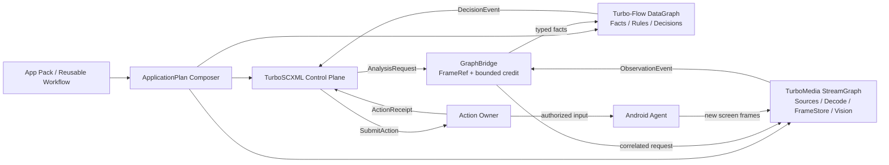

# TurboInteract

**Perception-driven interaction and automation built on TurboMedia StreamGraph, Turbo-Flow and TurboSCXML.**

TurboInteract is a headless-first C11-oriented application-composition and device-interaction framework. It connects continuous media processing, typed observation/data processing, event-driven control statecharts and authorized device actions. **It does not introduce a third graph scheduler or a replacement media engine.**

> **Status:** Architecture/design phase. The upstream `TurboMedia::StreamGraph v2` and several TurboInteract adapters in these documents are **proposed, not implemented**. The current TurboMedia Pipeline is a restricted FFmpeg/RTP pipeline. Do not treat design API names or YAML snippets as existing SDK interfaces.

## Runtime architecture

See **[complete architecture diagrams](docs/architecture/DIAGRAMS.md)** for the detailed three-plane layout, FrameRef/pin ownership sequence, Action verification loop, SCXML Supervisor and App Pack compilation.

- **TurboMedia StreamGraph**: media Source/Node/Sink, decode/filter, frame memory ownership, bounded fan-out, CPU/GPU memory domains, and optional vision processors. A general `StreamGraph v2` is a required upstream workstream.
- **Turbo-Flow**: typed Observation/Fact events, pure transformations, filtering, routing, keyed aggregations and explicit decision outputs. It never owns raw GPU frames or Android input state.
- **TurboSCXML**: Device Supervisor and Task statecharts, timed awaiting, invocation, cancellation, switching active analysis profiles and coordinating owner-managed shutdown. It does not run video processing.
- **GraphBridge / FrameStore**: immutable, generation-fenced FrameRef, credit-backed FrameLease, and bounded request/response across graphs. DataGraph messages never carry raw `AVFrame*`.
- **Action Owner**: sole external input-effect owner, with capability/authorization gates, pointer leases, outcome-unknown handling and separate postcondition verification.
- **App Packs**: immutable, versioned bindings of target semantics, models, StreamGraph and DataGraph configurations, SCXML programs and reusable tasks.

## Repository ownership

TurboInteract owns the application plan composer, App Pack resolver, GraphBridge contracts/adapters, Action Owner, device session integration, Android agent integrations and app-specific conformance. It does **not** duplicate Salts CNet, TurboMedia codecs/pipelines, Turbo-Flow graph execution, TurboSCXML Statechart execution or Praktor DAG execution.

## Architecture and delivery

- [Rendered architecture diagrams (Mermaid)](docs/architecture/DIAGRAMS.md)
- [Detailed architecture](docs/architecture/ARCHITECTURE.md)
- [Contracts and lifecycle](docs/architecture/CONTRACTS.md)
- [Delivery plan and acceptance gates](docs/architecture/ROADMAP.md)

Cross-repository prerequisites should be tracked separately in the source repository that owns them, and linked from TurboInteract issues.

## Baseline

- [TurboMedia](https://github.com/qigao/turbomedia): source/codec/RTP and restricted `turbo.media.pipeline/v1` already exist. StreamGraph v2 and decoded FrameStore are **not** existing production APIs.
- [Turbo-Flow](https://github.com/qigao/turbo-flow): `.flow`, typed operations, bounded ingress, keyed state and event-time windows exist, but no built-in vision/GPU/Android domain.
- [TurboSCXML](https://github.com/qigao/turbo-scxml): bounded host Event/Invoke/Cancel adapters, CFlow Statechart runtime and generation-aware Host routing exist.
- [Praktor](https://github.com/qigao/praktor): reusable YAML workflows and reviewed HostTool API, optional above the live task controller.

All newly proposed public names and config grammars must be implemented and qualified before being advertised as supported.
