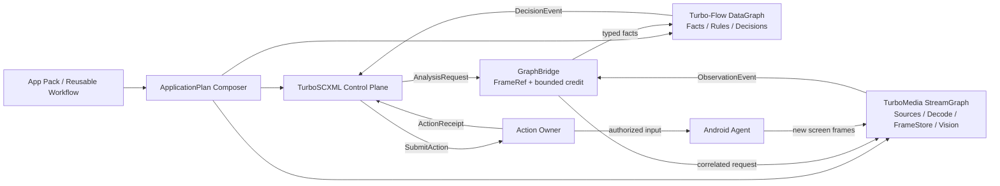

# TurboInteract Architecture v1 — StreamGraph + Turbo-Flow + TurboSCXML

**Status:** Proposed implementation specification (2026-10-12).  
**Repository:** `qigao/turbo-interact`  
**Authority:** upstream public headers and tests > installed SDK > this proposal. No design API in this file may be presented as implemented before executable qualification.

## 1. Objective and non-goals

TurboInteract is a headless-first perception-to-action system for Android first, with desktop/robotics capability added only through explicit providers. It supports reusable application/game packs, source-independent media/vision processing, typed facts and decisions, event-driven statecharts, and permissioned input effects. Qt is not a dependency.

**Non-goals:** a second media decoder, a second dataflow scheduler, a new general statechart runtime, a new universal network stack, an implicit model-chooser, or a generic workflow language duplicating Praktor. The system must not make `AVFrame*`, device pointers, GPU handles or mutable provider state part of the persistent workflow format.

## 2. Dependency and authority map

See the [architecture diagram collection](DIAGRAMS.md) for control/data/media ownership, FrameStore pin transfer, action verification and startup/drain sequencing.



**Ownership is strict:**

| Owner | Sole mutable truth | Outputs | Must not own |
| --- | --- | --- | --- |
| StreamGraph Owner | media graph, source/codec/processor state, execution deadlines | FrameRef, encoded output, observations | SCXML active configuration, Action receipt |
| FrameStore Owner (within StreamGraph) | frame slots, lease credits, CPU/GPU allocations, fences | FrameRef/Lease | Turbo-Flow stage data, workflow state |
| GraphBridge Owner | reservation, request correlation, bounded delivery credits | copied typed event/receipt | raw frame memory or provider session |
| Turbo-Flow Owner | typed messages, keyed/window state, graph execution | facts, decisions, ActionIntent proposals | video frame leases, device effects |
| SCXML Session / Host | desired application mode, task progress, invocations, event inbox | typed lifecycle/analysis/action commands | actual decoder, model or device state |
| Action Owner | authorized input session, pointer leases, attempt outcomes | ActionReceipt | business postcondition |
| Model Provider Owner | model/session context, inference work and resources | ObservationEvent | device gestures |
| Device Session Owner | transport identity, permissions, session generation | capability/state snapshots | a second Statechart |

Device Session is a resource owner; SCXML supervises its *desired behavior* and observes status. A status/receipt is never itself authority to free another owner's resources.

## 3. Deployment topology

The first deployable is **one PC process, one Android ScreenAgent and optional AccessAgent APK**. TurboInteract processes use installed SDKs, not checked-out source subtrees at runtime.

- PC: C11 core/graph adapters, model providers as optional DSOs, service/CLI; native viewer may be added independently.
- Android ScreenAgent: scrcpy-derived authorized screen capture/MediaCodec, UHID only where authorized/capable.
- Android AccessAgent: user-enabled AccessibilityService with explicit permission and UI-node/gesture adapter; optional MediaProjection capture.
- External AOA/ESP32: separate hardware input providers, never a fallback from missing UHID/accessibility.

Later process splitting requires explicit brokered shared-memory/GPU descriptor passing and crash-recovery contracts. **A local FrameRef ID alone is never a remote-memory transport.**

## 4. Authoring and compilation

App Pack is a declarative, versioned bundle (models, templates, targets, configuration and reusable tasks), not executable authority. One `ApplicationPlan` is assembled before starting any side effects.

1. Parse `AppPack` manifest and pinned dependencies; reject unknown fields, unresolved bindings, model digests, ABI mismatches or ambiguous providers.
2. Resolve target semantic names (e.g. `ui.start`) and app/device compatibility.
3. Build a **StreamGraph media subplan**, using TurboMedia's future `stream/v2` compiler. The current `pipeline/v1` cannot compile this plan.
4. Build a **Turbo-Flow .flow subplan** only when needed; register its existing typed operation descriptors and providers.
5. Compile SCXML statechart(s); validate all event names, host adapter/Invoke capability and bounded mailbox capacities.
6. Validate cross-graph bridge port contracts: event schema/version, directions, frame scope, quota, ownership, deadlines and cancel path.
7. Freeze an immutable `ApplicationPlan` with hashes of its graph configs, SCXML program, App Pack and model resources.
8. On start, materialize owners/resources in dependency order and publish generation only after all admission checks pass.

A single application may include direct StreamGraph -> SCXML Observation events, with no Turbo-Flow subplan. This is a valid minimal specialization of the same architecture, **not a compatibility fallback**; the plan explicitly selects it. Turbo-Flow is required when a declared DataGraph exists.

### Proposed composition manifest (not executable today)

```yaml
api_version: turbo.interact.application/v1
id: game.example
version: 1.0.0

app:
  package: com.example.game
  required_permissions: [screen.capture, input.uhid]

artifacts:
  media: flows/game-media.stream.yaml
  facts: flows/game-facts.flow
  supervisor: states/device.scxml
  session: states/game.scxml

models:
  - id: game-ui
    provider: opencv.template
    digest: sha256:EXACT_CONTENT_DIGEST
    input: video.frame.rgba8
    output: interact.observation/v1

targets:
  ui.start: {recognizer: game-ui, class: start}

action:
  provider: android.uhid
  max_active_pointers: 4

budgets:
  frame_slots: 12
  pending_analysis: 4
  pending_actions: 8
  event_queue: 64
```

Model and Graph providers must supply authoritative schema/ABI at preflight; this manifest cannot upgrade their capabilities.

## 5. StreamGraph: required upstream evolution

Current TurboMedia `pipeline/v1` has a hard-coded factory list and selects two whole-graph modes (FFmpeg vs Runtime/RTP). General StreamGraph needs typed Source/Processor/Sink registration and subplans, without rewriting libavcodec/libavfilter.

**Port data types:** ByteStream, RTPPacket, EncodedPacket, VideoFrame, AudioFrame, ObservationEvent. Media ports negotiate pixel/sample formats, dimensions, timebase, memory domain, synchronization and transform metadata; no silent conversion.

**Required nodes:** ffmpeg.input/demux/decode/filter/encode/mux/output, runtime RTP adapters, frame.tee, frame.sample, frame.convert, frame.map, frame.latest, vision provider invocation, observation.emit. Each node declares format/ownership/cancel/drain.

**Execution:** one owner per mutable codec/filter instance; separate bounded downstream lanes; decoder never synchronously waits for slow OCR when a sample/latest branch is selected. Explicit branch QoS and failure domains:

- `ordered.lossless`: block within deadline or fail; used by record/encode.
- `sample`: intentionally admit selected frames at bounded rate; used by detector.
- `latest`: coalesce unclaimed frames safely; used by preview/fast detection.
- No drop-oldest of an already claimed/pinned frame.
- Shared upstream failure terminates affected consumers; branch-specific failures propagate according to declared policy.

Current `turbo_media_source_t` is encoded-track/source publication; its callback payload is **not** a decoded frame lease. It can become a Source adapter, not the FrameStore itself.

## 6. FrameStore and graph bridging

A `FrameRef` is a *value identity*, not a pointer and not evidence of retention:

```c
/* PROPOSED ABI, not an upstream API */
typedef struct {
    uint64_t store_id;
    uint64_t store_generation;
    uint32_t slot;
    uint32_t slot_generation;
    uint64_t frame_id;
    uint64_t source_session_generation;
    uint64_t display_generation;
} ti_frame_ref;
```

FrameStore manages fixed credits for owned CPU buffers and/or GPU surfaces. It may internally wrap a Salts ref-counted `mem_buffer_t`; GPU resource ownership and fences are separate. `frame_acquire(ref)` validates store/slot/session generations and returns a temporary Lease or `STALE_FRAME`. The Lease is the only authority to map/read/mutate a frame. Inference providers must not retain a borrowed pixel view past `unmap`.

**Cross-graph asynchronous request must use reserved credit**:

```text
reserve frame pin (owner) + reserve bridge event slot
    -> prepare/copy FrameRef, request_id, generation, deadline
    -> commit event to selected consumer
    -> consumer takes pin, resolves frame, acquires Lease, executes
    -> release Lease and pin -> publish terminal AnalysisResult
```

If preparation or publication fails, release both reservations. Publication moves credit; it does not copy ownership. Fan-out requires **one pin per consumer**, so cloning a Turbo-Flow message cannot duplicate one credit. A weak FrameRef may be carried in ordinary facts without pinning, but delayed request must tolerate `STALE_FRAME` or reserve a pin before enqueue.

Within one process, copying the small FrameRef/typed payload is normal; zero-copy refers only to frame backing. Across processes, a broker must transfer OS/shared GPU handles, hold independent credits and provide crash reclaim. Across machines, FrameRef cannot resolve without a media transfer.

## 7. Typed cross-domain events

The supported domain envelope is versioned, pointer-free and immutable, with bounded payload sizes:

```text
EventEnvelope {
  schema_id, version, event_id, correlation_id,
  plan_generation, source_session_generation,
  created_monotonic_ns, expires_monotonic_ns,
  payload: Observation | AnalysisRequest | AnalysisResult
         | ActionIntent | ActionReceipt | OwnerStatus
}
```

Event types:
- `ObservationEvent`: frame identity, device/display generation, capture provenance, geometry, recognizer/model digest, typed detection payload.
- `AnalysisRequest`: target recognizer, frame ref, ROI, deadline, request ID and optional pin ticket.
- `AnalysisResult`: correlated result/status; result may be stale, canceled, timed out or failed.
- `ActionIntent`: desired effect, target, evidence ID, capability requirements, task/attempt identity, deadline and authority.
- `ActionReceipt`: transport/agent/backend completion level and outcome `COMPLETED/FAILED/CANCELLED/UNKNOWN`.
- `OwnerStatus`: actual Resource status, generation and terminal/drain progress.

**Graph direction:** StreamGraph -> Observation Bridge -> Turbo-Flow -> SCXML decision event. SCXML -> AnalysisRequest -> StreamGraph. SCXML -> ActionIntent -> Action Owner, which publishes receipts -> SCXML/Turbo-Flow. If the DataGraph proposes an ActionIntent, it is only an untrusted *proposal* until the SCXML/Action Owner authority boundary authorizes it.

No callback recursively progresses a foreign graph or SCXML Session. Each bridge has explicit bounded admission, FIFO/correlation and terminal delivery. A full queue is reported, never silently retried.

## 8. SCXML: control plane, not stream scheduler

TurboSCXML has a W3C Statechart compiler, bounded host Event I/O, Invoke, cancellation and versioned CMeta event payload support. It can supervise two scopes:

- `DeviceSupervisor`: disconnected/connecting/authorized/preparing/ready/running/draining/failed.
- `ApplicationSession`: scene-specific task modes (login/lobby/combat/result) and `await` of receipts and postconditions.

Transitions send typed *commands* to resource owners: `PrepareGraph`, `ActivateVisionProfile`, `RequestAnalysis`, `SubmitAction`, `QuiesceGraph`, `DrainOwner`. These are AVAR Host adapters **to be built**, not existing SCXML primitives.

TurboSCXML <send>/<invoke> effect tickets are prepared/committed/discarded by Host. Host owns the actual child resource and its cancellation; invoke IDs/tokens and graph generation fence late callbacks. Nested statecharts may supervise concurrent independent tasks, but device input still passes the single Action Owner.

`SCXML state = DRAINING` never itself means resources are safe to destroy: wait for owner terminal and all bridge/FrameStore pin credits returned. Actual status comes from owners.

## 9. Action domain and postcondition

Action types are `Pointer` (Down/Move/Up/Hold), `Gesture` (Tap/Swipe/Pinch), `SemanticUI` (node-based), and `System`. Provider choice is explicitly bound (UHID, Accessibility, AOA, ESP32). Unavailable provider is an error, not a fallback.

The Action Owner admits immutable ActionSpec only after validating permission, provider capabilities, device generation, evidence freshness and deadline. It serializes conflicting inputs and owns TouchLease. Receipt levels distinguish accepted, transported, backend-reported complete and unknown. **Action completion is not task success**: SCXML verifies the effect against new observations.

On session disruption, all in-flight unconfirmed actions become `UNKNOWN` and are not automatically repeated. A new attempt requires new evidence and explicit policy.

## 10. Reusable flows and model packaging

An App Pack binds semantic target IDs to recognizer configurations and model digests. Recognition code is supplied by trusted Providers (OpenCV, OCR, ncnn, ONNX). Different games may supply different recognition graphs/models while using the same typed Fact graph and SCXML task program. Model inference is an optional StreamGraph node, not compiled into Turbo-Flow core.

Praktor can orchestrate multiple *bounded* Task invocations with `uses` and HostTool. Its HostTool synchronous result boundary is not a continuously streaming Frame or long-running Event subscription. TurboSCXML owns live task FSM; Praktor holds only outer DAG/task outputs.

## 11. Lifetime and startup/shutdown

**Startup**: verify model/app/permission -> allocate FrameStore -> configure sources/vision models -> register bounded Bridge -> compile/bind DataGraph -> build SCXML sessions and host endpoint -> start owners -> publish READY generation.

**Shutdown**: SCXML requests no new intents -> Action Owner quiesce/settle pointer leases -> stop new analysis requests -> seal Bridge reservations -> stop StreamGraph sources -> wait accepted analysis/graph messages to terminal -> drain FrameStore pins and GPU fences -> destroy graph/model/provider instances -> close SCXML Host/invoke/session and transport after their borrowing callbacks quiesce. Exact order depends on actual borrowing edges; build a dependency DAG and release in reverse ownership order, not by blind fixed sequence.

Deadlines must not pretend forcibly canceled FFmpeg/GPU calls have ended. Failed Drain returns observable `BUSY/TIMED_OUT` with retained safe resources; do not free anyway.

## 12. Implementation boundaries and failure modes

- **TurboMedia repository** owns new StreamGraph v2, decoded-frame pool/lease, source/processor/sink registration, FFmpeg Pipeline v1 migration and media conformance.
- **Turbo-Flow repository** owns its existing .flow typed data runtime; no core changes presumed for an initial Observation Bridge.
- **TurboSCXML repository** owns generic Event/Invoke/Statechart; AVAR-specific adapters stay in TurboInteract unless a genuinely reusable host primitive is proven.
- **TurboInteract repository** owns App Pack, ApplicationPlan assembly, FrameRef bridge adapter, model binding, Action Owner, Android Agent integration and end-to-end tests.
- **Praktor repository** already owns user DAG and reusable workflow language; no duplicated YAML scheduler in TurboInteract.

### Design acceptance

No component is called complete until tests cover: generation/ABA/reconnect; fan-out pin accounting; callback race with cancel/stop; graph error/queue full; CPU vs GPU copies; model switching; distinct game packs on same task definition; Android credential/permission refusal; action UNKNOWN without auto replay; Task verification only from fresh frames; installed SDK consumption; Windows/Linux/macOS and Android-qualified gates where applicable.
