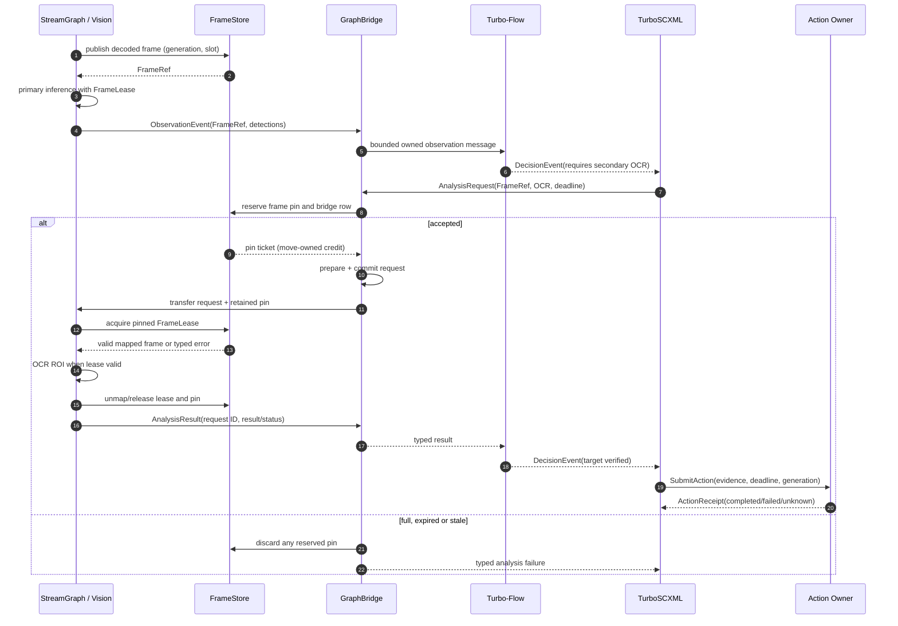
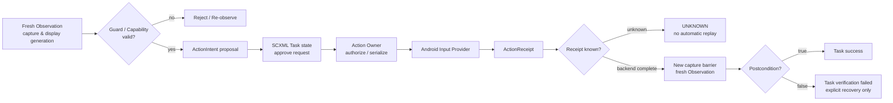
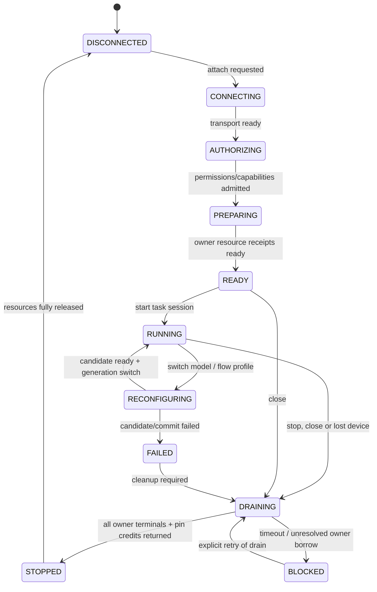
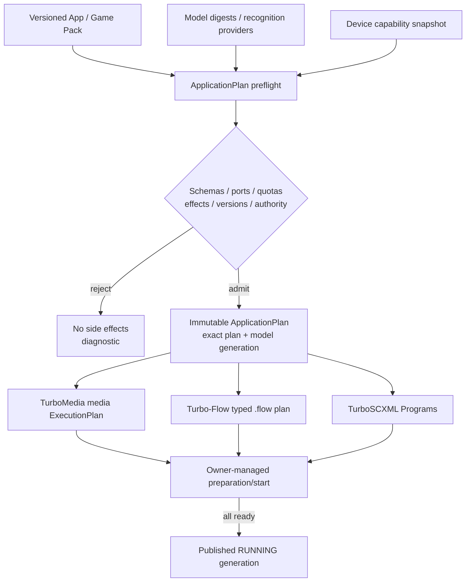

# TurboInteract — Architecture diagrams

> **Design diagrams, not implemented topology.** StreamGraph v2, FrameStore/FrameLease and TurboInteract bridge/adapters remain proposed. Turbo-Flow `.flow` and TurboSCXML Session/Host interfaces are existing upstream components. GitHub renders the Mermaid diagrams below; edit this document to update the diagrams together with the written contracts.

## 1. System architecture: three execution domains + one effect boundary

```mermaid
flowchart TB
    U["User / Praktor (optional)<br/>Reusable workflows"]
    P["App Pack & ApplicationPlan Composer<br/>Models / targets / capabilities / budgets"]
    U --> P

    subgraph CTRL["Control plane — TurboSCXML"]
      SUP["Device Supervisor<br/>connect / authorize / start / drain"]
      TASK["Application/Task Statechart<br/>await / verify / recover"]
      SUP -->|session status| TASK
    end

    subgraph MEDIA["Media plane — TurboMedia StreamGraph v2 (proposed)"]
      SRC["Source Providers<br/>Android / camera / file / RTSP / WebRTC"]
      CODEC["Demux / Decode / Convert"]
      STORE["FrameStore<br/>FrameRef / Pin / FrameLease"]
      VISION["Vision Nodes<br/>OpenCV / OCR / ncnn / ONNX"]
      OUT["Preview / Record / Stream Sink"]
      SRC --> CODEC --> STORE
      STORE --> VISION
      STORE --> OUT
    end

    subgraph DATA["Data plane — Turbo-Flow"]
      IN["Typed Observation Source"]
      RULES["Filter / Route / Keyed State / Rules"]
      DEC["Decision / ActionIntent proposal"]
      IN --> RULES --> DEC
    end

    BR["GraphBridge<br/>bounded typed messages + pin credit transfer"]
    ACT["Action Owner<br/>capability / admission / TouchLease / receipt"]
    DEV["Android Agents<br/>UHID / Accessibility / external HID"]

    P -->|compiled statecharts| SUP
    P -->|media plan + pinned models| SRC
    P -->|typed .flow plan| IN
    SUP -->|graph lifecycle commands| BR
    TASK -->|AnalysisRequest (FrameRef)| BR
    VISION -->|ObservationEvent (no pixel bytes)| BR
    BR -->|typed events| IN
    BR -->|correlated analysis request| VISION
    BR -.->|pin reservation / settlement| STORE
    DEC -->|DecisionEvent / proposed intent| TASK
    TASK -->|authorized SubmitAction| ACT
    ACT -->|input effect| DEV
    ACT -->|ActionReceipt| TASK
    DEV -->|next captured frame| SRC
```

**Authority:** SCXML owns desired control state, not media or GPU storage. StreamGraph owns frame bytes and model execution. Turbo-Flow owns typed data and derived facts, never device effects. The Action Owner alone admits externally visible actions. GraphBridge owns in-flight delivery credits but not the FrameStore allocation. Lines are logical control/data boundaries, not promises of a specific thread or wire transport.

## 2. Cross-graph frame lookup and one extra recognition pass



**Important:** This diagram's asynchronous request has a FrameStore pin reservation **before** queue publication. The copied FrameRef is a value identity and *does not itself pin*. Pin tickets are never duplicated when messages fan out; independent consumers need independent credits. Any actual CPU/GPU frame map requires the FrameStore's own device/fence guarantees.

## 3. Action/verification semantics and feedback loop



`DISPATCHED` and `COMPLETED` are not proof of a user-visible effect. Old buffered video frames cannot satisfy a strict post-action condition. A receipt must be joined with new observation evidence from a valid generation and capture-ordering barrier.

## 4. SCXML Device Supervisor and resource teardown



SCXML reports *desired state transitions*, not ownership of actual media resources. The `DRAINING -> STOPPED` edge requires authoritative status from StreamGraph, GraphBridge, Action Owner and borrowed provider closures. A timeout does **not** authorize destruction of in-flight GPU data, external HID touches or plugin memory.

## 5. App Pack compilation into two graphs and statecharts



The planned ApplicationPlan composer validates the **cross-domain** contracts; each upstream compiler remains authoritative for its native graph's semantics. A direct Observation-to-SCXML path must be explicitly selected at preflight if a plan does not need a Turbo-Flow subgraph; there is no silent runtime fallback.

## Source documents and issue tracking

- [Architecture contract](ARCHITECTURE.md)
- [FrameRef / Bridge / Action contracts](CONTRACTS.md)
- [Delivery roadmap](ROADMAP.md)
- [Architecture umbrella #1](https://github.com/qigao/turbo-interact/issues/1)
- [FrameStore/GraphBridge #3](https://github.com/qigao/turbo-interact/issues/3)
- [SCXML Host adapters #6](https://github.com/qigao/turbo-interact/issues/6)

### Diagram maintenance policy

When any of the following changes — a node's semantic owner, a cross-graph event schema, a pin-ticket lifecycle, SCXML transition, or the required start/drain order — update **these diagrams and the corresponding contract together** in the same PR. Mermaid source is reviewable and rendered by GitHub; do not replace it with an unversioned screenshot.
